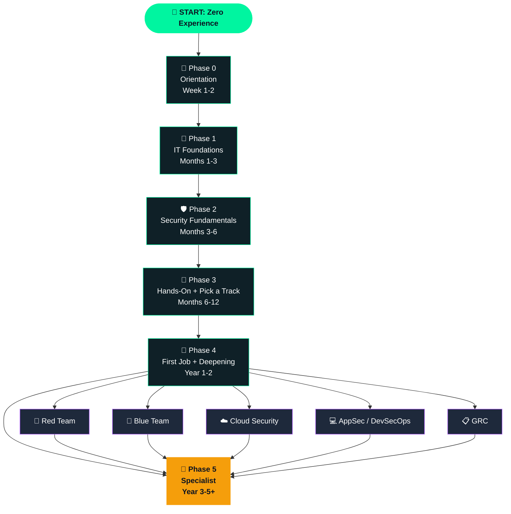
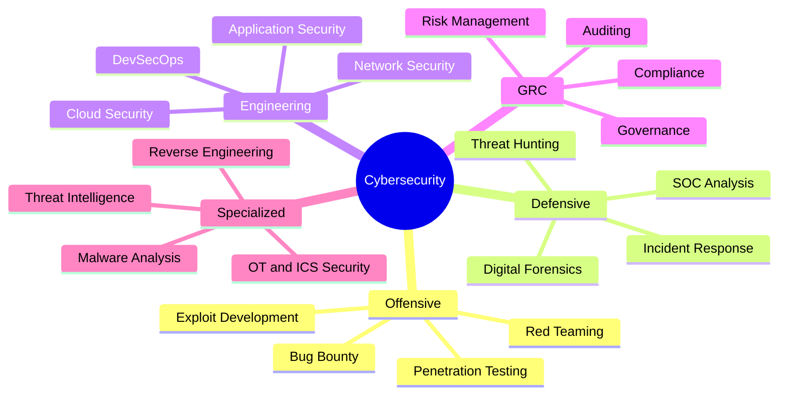
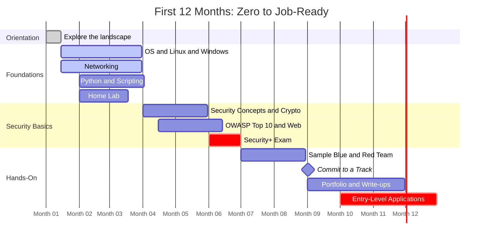
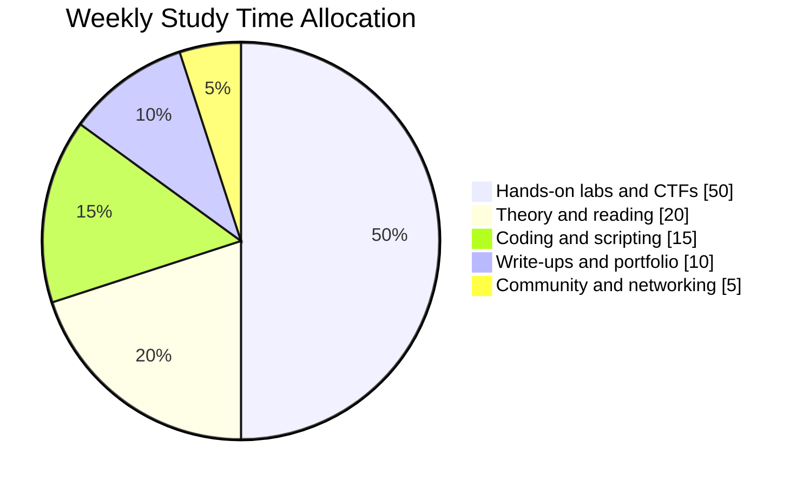
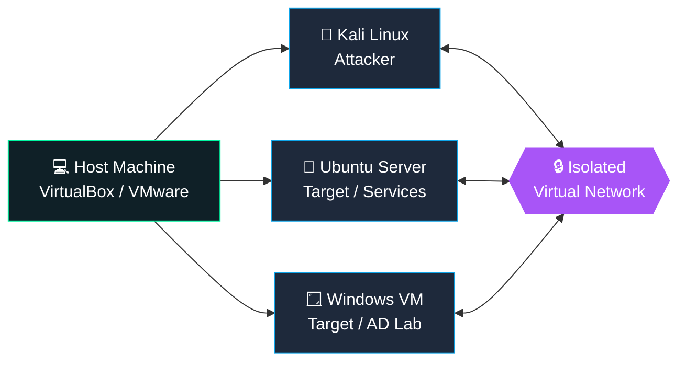
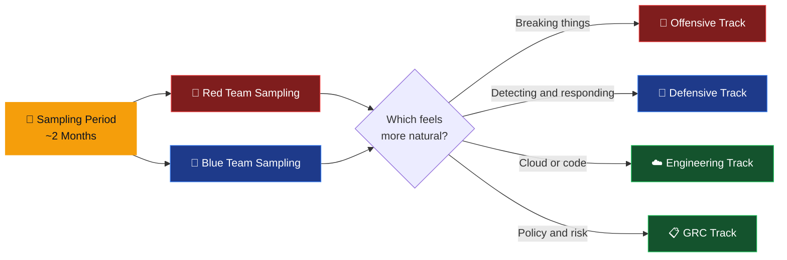
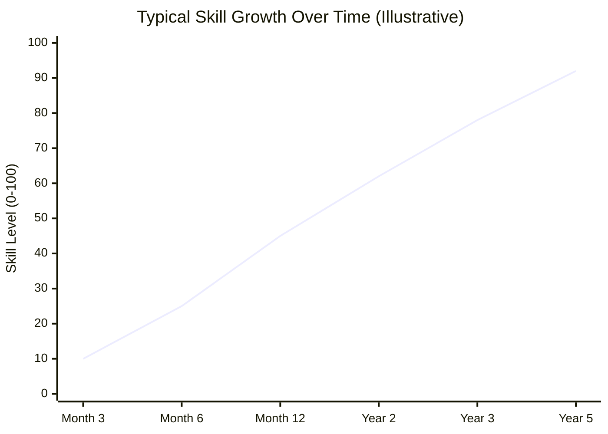
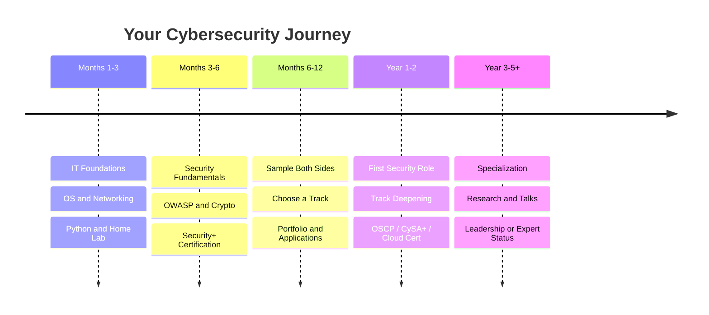

 

**A practical, step-by-step guide to becoming a cybersecurity specialist, with phases, milestones, tools, labs and certifications.**

[🗺️ Roadmap](#-the-big-picture) • [🧱 Phase 1](#-phase-1-it-foundations-months-1-3) • [🛡️ Phase 2](#-phase-2-security-fundamentals-months-3-6) • [🎯 Phase 3](#-phase-3-hands-on-skills--choosing-your-path-months-6-12) • [🚀 Phase 4](#-phase-4-professional-entry--intermediate-year-1-2) • [👑 Phase 5](#-phase-5-advanced-specialist-year-3-5) • [🧰 Resources](#-resource-hub)

---

## 📑 Table of Contents

- [🗺️ The Big Picture](#-the-big-picture)
- [🧭 Phase 0: Orientation](#-phase-0-orientation-week-1-2)
- [🧱 Phase 1: IT Foundations](#-phase-1-it-foundations-months-1-3)
- [🛡️ Phase 2: Security Fundamentals](#-phase-2-security-fundamentals-months-3-6)
- [🎯 Phase 3: Hands-On Skills & Choosing Your Path](#-phase-3-hands-on-skills--choosing-your-path-months-6-12)
- [🚀 Phase 4: Professional Entry & Intermediate](#-phase-4-professional-entry--intermediate-year-1-2)
- [👑 Phase 5: Advanced Specialist](#-phase-5-advanced-specialist-year-3-5)
- [🔁 Cross-Cutting Habits](#-cross-cutting-habits)
- [📅 Summary Timeline](#-summary-timeline)
- [🧰 Resource Hub](#-resource-hub)
- [🤝 Contributing](#-contributing)

---

## 🗺️ The Big Picture

> 💡 **Realistic expectation:** ~**12 months** to be job-ready at entry level, and **3-5 years** to reach genuine specialist level. Consistent hands-on practice matters far more than collecting certificates.

### Roadmap Flowchart

### 🧠 Cybersecurity Domain Map

### 🗓️ First 12 Months at a Glance

### ⏱️ Suggested Weekly Time Split

---

## 🧭 Phase 0: Orientation (Week 1-2)

**Goal:** Understand the landscape before diving in.

| Area | Focus |
|------|-------|
| 🔴 **Offensive (Red Team)** | Penetration testing, red teaming, exploit development |
| 🔵 **Defensive (Blue Team)** | SOC analysis, threat hunting, incident response, forensics |
| ☁️ **Engineering / Architecture** | Cloud security, AppSec, DevSecOps, network security |
| 📋 **GRC** | Governance, risk, compliance, auditing |
| 🧬 **Specialized** | Malware analysis, reverse engineering, threat intel, OT/ICS |

> You don't need to choose yet. **Phases 1-2 are common to everyone.**

> [!WARNING]
> **Ground rules:** Only practice on systems you own or on labs designed for it. Unauthorized access is illegal, even "just to test." Learn the basics of relevant laws (e.g., India's IT Act, or the laws where you plan to work).

---

## 🧱 Phase 1: IT Foundations (Months 1-3)

> Most beginners skip this and struggle later. **You can't secure what you don't understand.**

### 1️⃣ Computer & OS Fundamentals
- How hardware, memory, processes, and file systems work
- **Windows:** Active Directory basics, registry, services, event logs, PowerShell
- **Linux:** command line, file permissions, users/groups, package management, services, logs. Aim to live in the terminal.

### 2️⃣ Networking (Most Important Foundation)
- OSI and TCP/IP models, IP addressing, subnetting, MAC, ARP
- DNS, DHCP, HTTP/HTTPS, FTP, SSH, SMTP, TLS
- Routers, switches, firewalls, VLANs, NAT, VPNs
- Practice with **Wireshark**: capture traffic and read packets

### 3️⃣ Programming & Scripting

| Language | Priority | Use Case |
|----------|:--------:|----------|
| 🐍 **Python** | ⭐⭐⭐⭐⭐ | Automation, parsing, simple tools, sockets |
| 🐚 **Bash** | ⭐⭐⭐⭐ | Linux automation |
| 🪟 **PowerShell** | ⭐⭐⭐⭐ | Windows automation and admin |
| 🗄️ **SQL** | ⭐⭐⭐ | Web security, data analysis |
| 🌐 **JavaScript / HTML** | ⭐⭐⭐ | Web security |
| ⚙️ **C / C++ / Assembly** | ⭐⭐ (later) | Reverse engineering, exploit development |

### 4️⃣ Build a Home Lab

<b>📚 Recommended Resources for Phase 1 (click to expand)</b>

| Topic | Resource |
|-------|----------|
| Network+/Security+ videos | [Professor Messer](https://www.professormesser.com/) (free) |
| Intro programming | [CS50](https://cs50.harvard.edu/) |
| Linux | [OverTheWire: Bandit](https://overthewire.org/wargames/bandit/) |
| Networking | [Cisco Networking Academy](https://www.netacad.com/) |
| Guided start | [TryHackMe Pre-Security Path](https://tryhackme.com/) |

**🎓 Optional certs:** CompTIA Network+ or CCNA (A+ if totally new to IT)

> ✅ **Milestone:** You can explain what happens when you type a URL into a browser (DNS → TLS → HTTP) and write a short Python script to automate a task.

---

## 🛡️ Phase 2: Security Fundamentals (Months 3-6)

### 🔑 Core Concepts
- **CIA triad**, authentication vs. authorization, least privilege, defense in depth
- Threat actors, **Cyber Kill Chain**, **MITRE ATT&CK** framework
- **Cryptography:** symmetric/asymmetric encryption, hashing, digital signatures, PKI, certificates
- **Common attacks:** phishing, malware, DoS/DDoS, MITM, password attacks, social engineering
- **Vulnerability management:** CVE, CVSS, patching
- **Security controls:** firewalls, IDS/IPS, EDR, antivirus, SIEM, WAF

### 🌐 Web Security Fundamentals: OWASP Top 10
SQL injection • XSS • CSRF • Broken access control • SSRF • Insecure deserialization • and more.

### 🧪 Hands-On Practice

| Platform | What to Do |
|----------|-----------|
| [TryHackMe](https://tryhackme.com/) | Complete Beginner, Jr Penetration Tester, SOC Level 1 paths |
| [PortSwigger Academy](https://portswigger.net/web-security) | Free, excellent web security labs |
| [picoCTF](https://picoctf.org/) | Beginner-friendly CTFs |

### 🏅 Certification

> Widely recognized and a common HR filter for entry-level roles.

> ✅ **Milestone:** You can explain the OWASP Top 10 with examples, use **Nmap, Wireshark, and Burp Suite** at a basic level, and have solved **30-50 beginner labs/challenges**.

---

## 🎯 Phase 3: Hands-On Skills & Choosing Your Path (Months 6-12)

Spend ~**2 months sampling both sides**, then commit to a track.

<table>
<tr>
<td width="50%" valign="top">

### 🔵 Blue Team Sampling
- Read logs, investigate alerts
- Use a SIEM: **Splunk Free, Elastic/Wazuh, Security Onion**
- Learn **Sysmon**, Windows event IDs, **Snort/Suricata**, **YARA**, **Sigma** rules
- **Platforms:** LetsDefend, Blue Team Labs Online, CyberDefenders

</td>
<td width="50%" valign="top">

### 🔴 Red Team Sampling
- Recon → Scanning → Exploitation → PrivEsc → Post-exploitation
- **Platforms:** Hack The Box (Starting Point, easy machines), TryHackMe offensive paths
- **Tools:** Nmap, Burp Suite, Metasploit, Gobuster, John/Hashcat, BloodHound (later)

</td>
</tr>
</table>

### 📝 Document Everything
Start a **blog, GitHub, or Notion** with write-ups of machines you've solved, lab setups, and small scripts. **This becomes your portfolio.**

### 🏅 Entry Certs by Track

| Track | Certifications |
|:-----:|----------------|
| 🔴 Offensive | `eJPT` → `PNPT` or `CPTS` |
| 🔵 Defensive | `BTL1`, `CompTIA CySA+` |
| 📋 GRC | `ISC2 CC`, `ISO 27001 Foundation` |

> ✅ **Milestone:** You've chosen a track, built a visible portfolio, and are applying for entry-level roles: **SOC Analyst L1, Junior Pentester, Security Analyst, Vulnerability Analyst, IT Auditor.**

---

## 🚀 Phase 4: Professional Entry & Intermediate (Year 1-2)

**Get a job.** Paid experience beats solo study. Common entry points: SOC analyst, helpdesk/sysadmin → security, or an internship. Many strong specialists started in IT support or networking.

### Choose Your Deep-Dive Track

<b>🔴 A. Penetration Testing / Red Team</b>

- Advanced web app testing (business logic, API testing, auth bypasses)
- **Active Directory attacks:** Kerberoasting, pass-the-hash, lateral movement, domain escalation
- Network and wireless pentesting, mobile app testing (Android/iOS)
- **Reporting skills**: a pentest is only as useful as its report

**Certs:** `OSCP` (industry benchmark) → `CRTO`, `OSWE`, `OSEP`

<b>🔵 B. SOC / Incident Response / Threat Hunting</b>

- **Detection engineering:** SIEM queries and detection rules
- Incident response lifecycle (NIST), memory and disk forensics (Volatility, Autopsy)
- Threat hunting using hypotheses and ATT&CK
- Malware triage, EDR tools (CrowdStrike, Defender, SentinelOne)

**Certs:** `CySA+`, `GCIH`, `GCFA`, `BTL2`, `GCIA`

<b>☁️ C. Cloud Security</b>

- Master **one cloud first** (AWS, Azure, or GCP): IAM, networking, logging, storage security
- Infrastructure as Code (**Terraform**), container/Kubernetes security
- CSPM tools, cloud attack paths

**Certs:** `AWS Security Specialty`, `AZ-500`, `CCSP`, `CKS`

<b>💻 D. Application Security / DevSecOps</b>

- Secure code review, **SAST / DAST / SCA**, threat modeling (**STRIDE**)
- CI/CD pipeline security, secrets management

**Certs:** `OSWE`, `GWEB`, relevant secure coding training

<b>📋 E. GRC (Governance, Risk, Compliance)</b>

- Frameworks: **ISO 27001, NIST CSF/800-53, SOC 2, PCI-DSS, GDPR**
- Risk assessments, policy writing, audits, vendor risk management

**Certs:** `CISA`, `CRISC`, `CISM`, later `CISSP`

### 📈 Intermediate Skill Progression

---

## 👑 Phase 5: Advanced Specialist (Year 3-5+)

This is where you become **known for something specific.**

| Path | Specialties | Advanced Certs |
|------|-------------|----------------|
| 🔴 **Offensive** | Exploit development (buffer overflows, ROP, heap, kernel), red team ops & C2, evasion, hardware/IoT hacking, vulnerability research, bug bounty | `OSEE` `OSED` `CRTL` `GXPN` |
| 🔵 **Defensive** | Malware analysis & reverse engineering (IDA/Ghidra, x64dbg), advanced forensics, threat intelligence, purple teaming, detection engineering at scale | `GREM` `GCTI` `GNFA` |
| 🏛️ **Architecture / Leadership** | Security architecture, zero trust design, large-scale threat modeling, CISO track (risk, budgeting, communication) | `CISSP` `CISM` `SABSA` `CCSP` |
| 🧬 **Niche Domains** | OT/ICS/SCADA, automotive, medical devices, AI/ML security, blockchain & smart contract auditing | Domain-specific |

### 💪 Advanced Habits
- 📖 Read research papers, conference talks (**DEF CON, Black Hat, BSides**), and CVE write-ups
- 🎤 Give talks, publish research or tools, contribute to open source
- 💰 Participate in bug bounties (**HackerOne, Bugcrowd**) for real-world experience
- 🧑‍🏫 Mentor others: teaching deepens your own understanding

---

## 🔁 Cross-Cutting Habits

| # | Habit | Why It Matters |
|:-:|-------|----------------|
| 1 | ⏰ **Practice daily/weekly** | Even 1-2 hours a day compounds enormously |
| 2 | 📰 **Stay current** | Follow The Hacker News, Krebs on Security, BleepingComputer, researchers on X/Mastodon/LinkedIn |
| 3 | 🗣️ **Build soft skills** | Report writing, explaining risk to non-technical people, teamwork |
| 4 | 🤝 **Network** | Local meetups, BSides, OWASP chapters, Discord/Slack communities |
| 5 | 🚫 **Don't cert-hoard** | 1-2 well-chosen certs + strong portfolio beats 10 certs with no practical skill |

---

## 📅 Summary Timeline

| Period | Focus | Output |
|--------|-------|--------|
| **Months 1-3** | OS, networking, Python, home lab | Strong IT base |
| **Months 3-6** | Security concepts, OWASP, labs | Security+ |
| **Months 6-12** | Pick track, CTFs, portfolio | Entry cert + job applications |
| **Year 1-2** | First role + track deepening | OSCP / CySA+ / cloud cert |
| **Year 3-5+** | Specialization, research, leadership | Expert-level reputation |

---

## 🧰 Resource Hub

### 🎮 Practice Platforms

| Platform | Best For | Cost |
|----------|----------|:----:|
| [TryHackMe](https://tryhackme.com/) | Guided beginner learning | Free + Paid |
| [Hack The Box](https://www.hackthebox.com/) | Realistic machines, pentesting | Free + Paid |
| [PortSwigger Web Security Academy](https://portswigger.net/web-security) | Web app security | Free |
| [OverTheWire](https://overthewire.org/wargames/) | Linux and wargames | Free |
| [picoCTF](https://picoctf.org/) | Beginner CTFs | Free |
| [LetsDefend](https://letsdefend.io/) | SOC analyst practice | Free + Paid |
| [CyberDefenders](https://cyberdefenders.org/) | Blue team challenges | Free + Paid |
| [Blue Team Labs Online](https://blueteamlabs.online/) | Defensive labs | Free + Paid |

### 🛠️ Essential Toolkit

### 📰 Stay Updated
[The Hacker News](https://thehackernews.com/) • [Krebs on Security](https://krebsonsecurity.com/) • [BleepingComputer](https://www.bleepingcomputer.com/) • [DEF CON](https://defcon.org/) • [Black Hat](https://www.blackhat.com/)

---

## 🤝 Contributing

Found an outdated resource or want to add a section? Contributions are welcome!

1. 🍴 Fork this repository
2. 🌿 Create a branch: `git checkout -b feature/improve-roadmap`
3. 💾 Commit your changes: `git commit -m "Add: new resource"`
4. 📤 Push to your branch: `git push origin feature/improve-roadmap`
5. 🔃 Open a Pull Request

---

## ⚖️ Disclaimer

This roadmap is for **educational purposes only**. Always practice ethically and legally, only on systems you own or have explicit written permission to test. Certification names and platforms may change over time; verify current details on official websites.

---

### ⭐ If this roadmap helped you, give it a star!

**Stay curious. Stay ethical. Keep hacking (legally). 🛡️**

